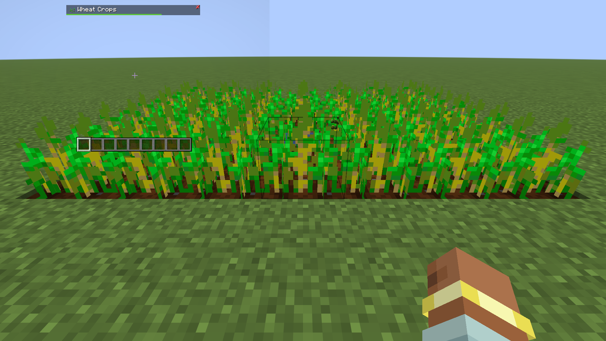
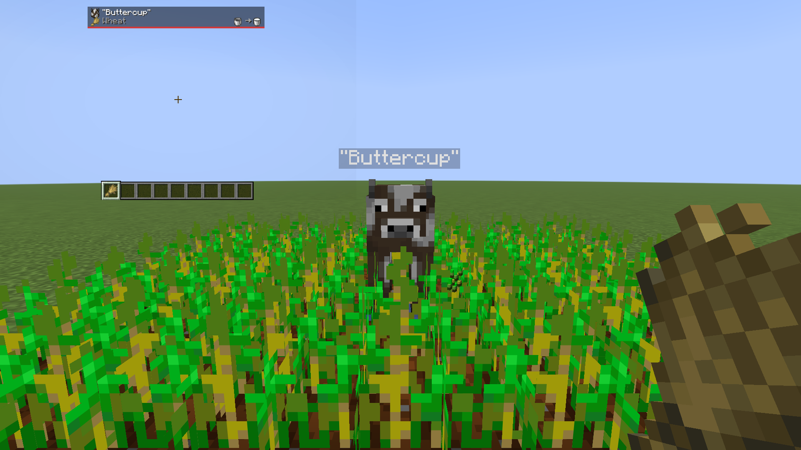

# Block Tip

A Minecraft Fabric mod. Names what you are looking at.

## Screenshots

## What This Mod Does

Look at a block or a creature within six blocks and its picture and name appear in a small card at the top of the screen, clear of the effect icons and under any boss bar that is up.

The card has two rows at most. The first is the name; the second, when there is anything to say, is one line of facts, as many as fit, least important cut first. Marks at the ends of the name line answer "will this tool do?" and "can mobs spawn here?" at a glance.

## Turning It Off

| Command | Effect |
|---------|--------|
| `/blocktip` | Flip it, whichever way it currently is |
| `/blocktip on` | On |
| `/blocktip off` | Off |
| `/blocktip sneak` | Only while sneaking |
| `/blocktip marks` | What the marks on the card mean, said in chat |

Anyone can use them, and each changes only your own card. It is on by default. The bare toggle gives back whatever you had, so turning tips off and on again returns you to sneak mode if that is where you were.

The same choice is on Block Tip's page in the Pandorical mods menu, as **Show tips**: Always, When sneaking or Off. It is the same setting as the command.

## Blocks You Already Know

| Command | Effect |
|---------|--------|
| `/blocktip hide` | Never name the block you are looking at again |
| `/blocktip hide <block> [<block>...]` | The same, for up to five named blocks |
| `/blocktip show` | Name the block you are looking at again |
| `/blocktip show <block> [<block>...]` | The same, for up to five named blocks |
| `/blocktip show all` | Forget the whole list |
| `/blocktip hidden` | Read the list back |

`show` works by looking at a hidden block even though no card appears for it. The list is per player and survives a mod being uninstalled for a while. The mods menu page lists the same blocks under **Hidden blocks**, each with a button to bring it back.

## Details Worth Knowing

- **Names arrive in your own language.** The facts under the name are in the server's language.
- **Blocks with no item still get named.** Fire, portals, the top half of a door: name, no picture.
- **Creatures show what middle-click would give you**: a spawn egg for a mob, the boat for a boat. Players get a plain head. A creature with a name tag is introduced by it.
- **A player's head is named for its player.**
- **Modded things say whose they are**: the mod's name sits small at the end of the name line. Vanilla things say nothing.
- **Whichever is nearer wins.** A cow in front of a wall names the cow.
- **The bottom edge is a gauge.** It fills as the block you are mining gives way. On a creature it is a red bar of the health it has left, on a crop a green bar of how far it has grown, full when it is ready to pick.
- **Spectators get no card.**

## What It Says About Vanilla

| Looking at | It says |
|------------|---------|
| A spawner | **Spawns Zombie** |
| A furnace | **Smelting**, **Out of fuel**, or **Idle** |
| A chest | **50% full · 7/15** |
| Redstone dust | **12/15** |
| Waxed copper | **Waxed** |
| A note block | **harp, F#3** |
| A hive | **3 bees, honey 4/5** |
| Farmland | **Watered** or **Dry** |

As many as fit share the line, most specific first: a lit furnace with something in it says both what it is doing and how full it is. A redstone power level, from a wire or from what a comparator would read, has a lightning mark in front of it. Container fill is said in quarters, or **Empty**, or **Full**. A loot chest nobody has opened says nothing about its contents, since counting them would roll the loot.

Crop growth is the green fill along the bottom edge: wheat and the other crops, stems, nether wart, cocoa and sweet berries.

### Animals

An animal's line starts with what it breeds on, the food's picture in front of its name. One that takes several foods shows them in turn, a second and a half each and up to eight, every animal of a kind in step.

What it gives you sits at the far end of the line, as two pictures and an arrow: bucket to milk for a grown cow or goat, bowl to stew for a grown mooshroom, shears to wool of its colour for a grown sheep that has not been sheared.

### The skull

A skull on the top-left corner of the block's picture means mobs can spawn on top of that block: the space above it has a block light level of zero.

## What To Hold

The end of the name line says whether what is in your hand will do. Nothing appears when anything will.

| At the end of the name | Means |
|------------------------|-------|
| Green tick | The drop is safe with what you are holding, or the crop is ripe |
| Red plus, with a tool | Right kind of tool, not hard enough: it will break but drop nothing |
| Red cross | Wrong tool, and swinging now loses the block. On a crop, that it is not ready yet |
| Yellow star, with a tool | Nothing is at stake. That tool would be quicker, or would give you the block itself |
| An enchanted book | This block drops **nothing** without silk touch |
| Shears | Shears give you the block itself: the leaves, the cobweb, the grass |

Red means swinging costs you something; yellow and green mean it does not. Each has its own shape as well as its own colour. The book and shears are read from the block's loot table, so they stay right for data packs and modded blocks.

## Boss Bars

When a boss bar is up, the card moves below it and takes its width. Looking at the creature that owns the bar, the card drops the health, and a vanilla boss such as the dragon gets no card at all, since the bar already says everything. A modded boss still gets a card, showing which mod it is from.

## For Other Mods

Other mods can add to the card through `BlockTipApi`:

- `line` - a fixed line for a block id
- `describe` / `illustrate` - a line, or a line with an item picture, worked out from the block in front of the player
- `describeEntity` - a line for a creature
- `name` / `nameEntity` - replace the card's title
- `icon` - a picture for a block with no item
- `growth` - a 0-to-1 growth fraction for a plant that has no age property
- `bossBar` / `bossBarCheck` - tell the card a boss bar is up
- `inspection` - let a claim or protection mod stop the card reading inside other players' blocks (the name still shows)
- the `block_tip:stand_in` scoreboard tag, for an entity that is really a block

Signatures, examples and the `breaks` version to declare are in [DEVELOPMENT.md](DEVELOPMENT.md#api-for-other-mods). [Crafter Template](https://github.com/fatlard1993/crafter-template), [Player Trade](https://github.com/fatlard1993/player-trade) and [Hemp Craft](https://github.com/fatlard1993/hemp-craft) are among the mods that use it.

## Pandorical

Block Tip runs server-side, and Pandorical is required on the server. The card is a Pandorical HUD, so a client with Pandorical needs no Block Tip jar. A vanilla client sees no card, though `/blocktip` still works for it.

## Development

Installing, building and the map of the source are in [DEVELOPMENT.md](DEVELOPMENT.md).

## License

MIT, see [LICENSE](LICENSE).
